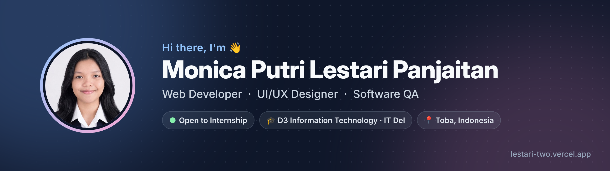

### Hi, I'm Monica 👋

Diploma 3 Information Technology student at **Institut Teknologi Del** who enjoys building web apps end to end —
from designing the interface in Figma to shipping it with Laravel and MySQL. Currently looking for an **internship** opportunity.

---

## 🌱 About Me

- 🎓 **D3 Teknologi Informasi**, Institut Teknologi Del (2024 – 2027)
- 💻 Focus: **Web Development**, **UI/UX Design**, and **Software Quality Assurance**
- 🏅 **Oracle AI Database Certified Foundations Associate** (2026)
- 🥇 **5th Place** — Pixelnoid Dev Weekend Season 2 (Machine Learning + Laravel)
- 📚 Currently exploring: Data Analysis, Machine Learning, Cyber Security, and Cloud (AWS)
- 🌍 Languages: Indonesian (native), English (intermediate)

---

## 🐍 Contribution Snake

<picture>
  <source media="(prefers-color-scheme: dark)"
    srcset="https://raw.githubusercontent.com/MonicaPanjaitan07/MonicaPanjaitan07/output/github-snake-dark.svg">
  <source media="(prefers-color-scheme: light)"
    srcset="https://raw.githubusercontent.com/MonicaPanjaitan07/MonicaPanjaitan07/output/github-snake.svg">
  
</picture>

---

## 📊 GitHub Stats

---

## 🛠️ Tech Stack

**Web Development**

**Data & Databases**

**Design & Tools**

---

## 🚀 Featured Projects

| Project | Description | Stack |
|---|---|---|
| [**Pardede Catering App**](https://github.com/MonicaPanjaitan07/Pardede-Catering-App) | Online catering ordering — a mobile app for customers and an admin website to manage every order. *Final Project 2, 2026.* | Laravel · MySQL · Figma |
| [**Web Firman Taylor**](https://github.com/MonicaPanjaitan07/web-firman-taylor) | Online tailoring order website, so customers don't have to travel and queue at the tailor. *Final Project 1, 2025.* | Laravel · PHP · MySQL · Figma |
| [**StudyMate-AI**](https://github.com/MonicaPanjaitan07/StudyMate-AI) | AI chatbot powered by Google Gemini to help students study. | JavaScript |
| [**lestari**](https://github.com/MonicaPanjaitan07/lestari) | My personal portfolio — bilingual, three themes, and a live visitor dashboard. | Next.js · React |

---

### 💌 Let's Connect

 

  

*"Design it with care, build it with heart."* 🌸

